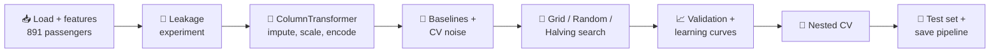
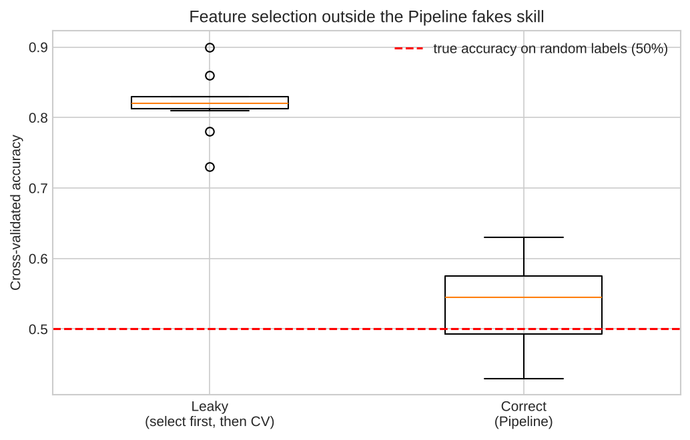
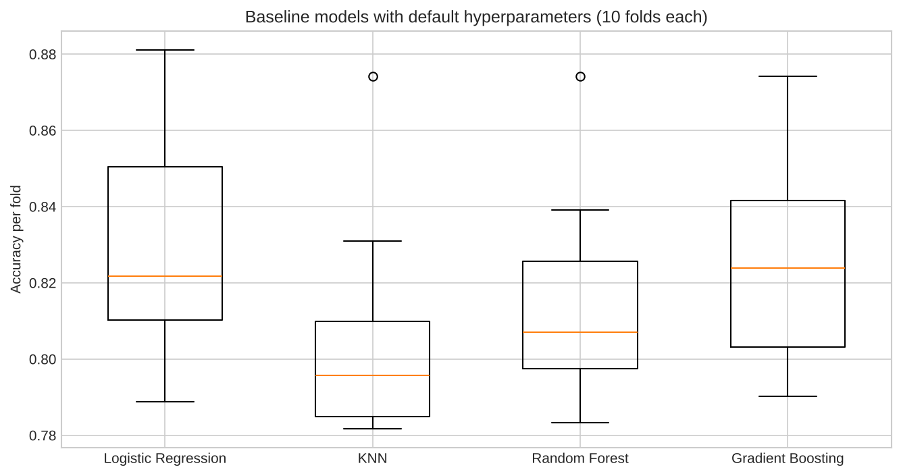
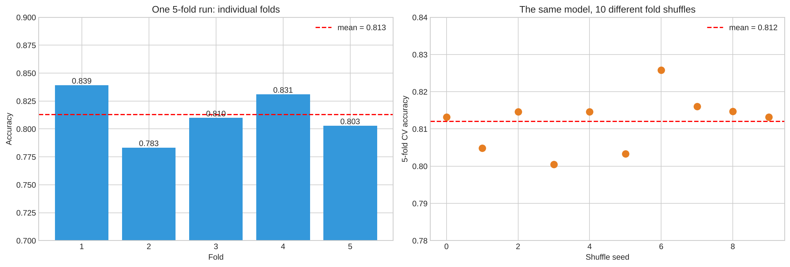
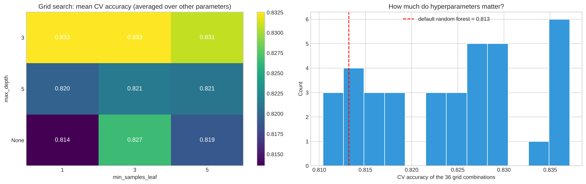
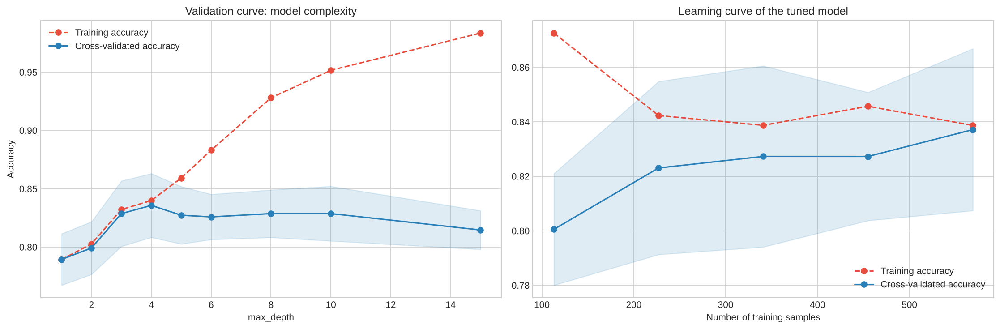
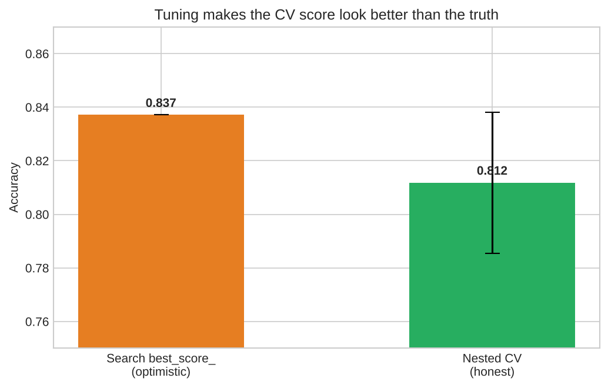
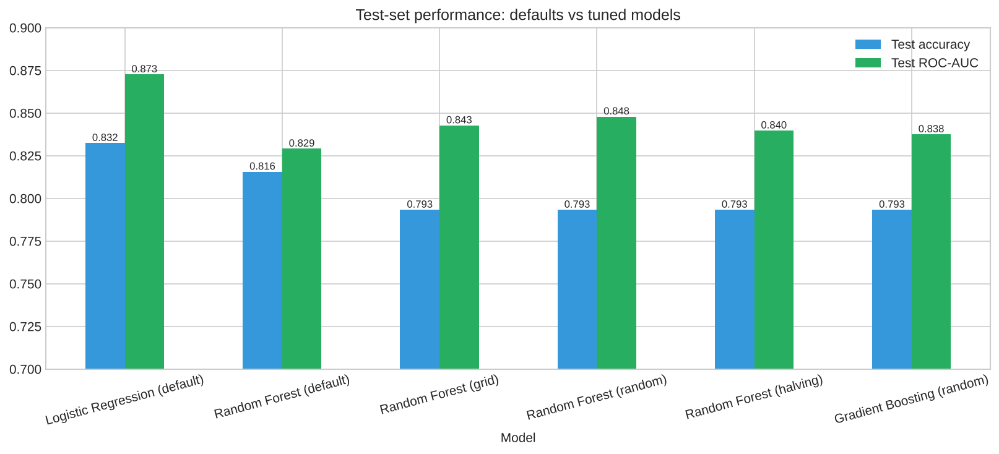

<div align="center">

# 🎛️ Hyperparameter Tuning, Cross-Validation & Pipelines

### Titanic survival prediction, done the professional way: leak-free pipelines, honest validation and efficient search


</div>

---

## 🎯 Objective
Learn how to build a **leak-free scikit-learn Pipeline** for mixed data (numeric, categorical, missing values), how **cross-validation** works and how noisy it is, how to tune hyperparameters with **Grid**, **Random** and **Successive-Halving** search, and how **nested cross-validation** gives an honest performance estimate.

**Dataset:** Titanic, 891 passengers (38.4% survived). Engineered features: `Title`, `FamilySize`, `IsAlone`, `HasCabin`. Split: **712 train / 179 test** (stratified).

## ⚡ Highlights

| | |
|---|---|
| 🚨 **Leakage experiment** | On pure random noise, selecting features *outside* the Pipeline gives **82%** accuracy; the correct Pipeline gives **53%** (chance) |
| 📏 **CV is noisy** | Single folds range **0.783 to 0.839**; 10 shuffles move the mean from 0.801 to 0.826 |
| 🔎 **3 search methods** | Grid, Random and Halving all land on shallow forests with CV **0.83 to 0.84** |
| 🧪 **Nested CV** | Honest accuracy **0.812** vs the search's own **0.837** (selection bias **2.5 points**) |
| 🏁 **Test set** | Tuned models did **not** beat the defaults; the untuned logistic regression was best (**0.832**) |
| 💾 **Deployable** | The whole pipeline is saved as one `.joblib` and predicts from raw passenger fields |

## 🔄 Pipeline



## 📂 Project Structure

```
hyperparameter-tuning-pipelines/
├── 📁 data/
│   └── Titanic-Dataset.csv            # 891 passengers, 12 columns
├── 📁 images/                         # 7 plots generated by the notebook
├── 📓 hyperparameter_tuning.ipynb     # full notebook with outputs
├── 📦 titanic_pipeline.joblib         # saved pipeline (preprocessing + tuned random forest)
├── 📄 requirements.txt
└── 📄 README.md
```

## 🚨 Why Pipelines? A Data-Leakage Experiment
Any step that **learns from data** (imputing, scaling, feature selection, encoding) must be fitted **only on the training part of each fold**. To show how much damage a leak can do, the notebook builds **pure noise**: 100 samples, 1,000 random features and random labels (honest accuracy = 50%).



| Procedure | Cross-validated accuracy (mean of 10 datasets) |
|---|---|
| ❌ Select the 20 "best" features on all labels, then CV | **0.82** (fake skill) |
| ✅ Feature selection inside the Pipeline | **0.53** (honest: guessing) |

## 🧱 Preprocessing Pipeline & Baselines
A `ColumnTransformer` imputes (median / most frequent), scales (only for scale-sensitive models) and one-hot encodes, all **inside** the cross-validation loop.



| Model (defaults, repeated 5-fold CV) | CV accuracy | ± std |
|---|---|---|
| **Logistic Regression** | **0.8293** | 0.026 |
| Gradient Boosting | 0.8244 | 0.026 |
| Random Forest | 0.8146 | 0.025 |
| KNN | 0.8055 | 0.027 |

The spread between models (2 points) is smaller than the fold-to-fold noise (± 2.6 points).

## 📏 How Reliable Is Cross-Validation?


One 5-fold run of the random forest scored **0.839, 0.783, 0.810, 0.831, 0.803** across folds. Repeating 5-fold CV with 10 different shuffles gave a mean of **0.812** (std 0.007, range 0.801 to 0.826). Differences smaller than ~1 point between candidates are noise.

## 🔎 Grid vs Random vs Halving Search

| Method | Candidates tried | Best CV accuracy | Test accuracy |
|---|---|---|---|
| Grid search | 36 | 0.8371 | 0.7933 |
| Random search | 30 | 0.8371 | 0.7933 |
| Halving search | 90 (across 4 rounds) | 0.8306 | 0.7933 |

- All three find **shallow forests** (`max_depth` 3 to 4) with CV accuracy 0.83 to 0.84: the search landscape is flat
- **Halving** starts 60 candidates on 20 samples, keeps 20 for 60 samples, 7 for 180 and the final 3 on all 540; it pays off when fits are expensive, not on a dataset this small



`max_depth` is the hyperparameter that matters: depth 3 averages **0.831 to 0.833**, depth 5 about 0.82, unlimited depth 0.814 to 0.827. The default forest (0.813) sits near the bottom of all 36 combinations, and the best ones are about 2.4 points better.

## 📈 Validation & Learning Curves


- **Validation curve:** training accuracy climbs from 0.789 to **0.983** at depth 15, while cross-validated accuracy **peaks at depth 4 (0.836)** and falls to 0.815: deeper trees overfit
- **Learning curve:** training and validation curves meet at about **0.84**, so more rows of the same kind would add little; better features would help more

## 🧪 Nested Cross-Validation: The Honest Estimate
The best score of a search is **optimistic** (the winner was picked *because* it scored best on those folds). Nested CV evaluates the whole "tune, then predict" procedure on data the search never saw.



| Estimate | Accuracy |
|---|---|
| Search `best_score_` (optimistic) | 0.8371 |
| **Nested CV (honest)** | **0.8118 ± 0.026** |
| Selection bias | **+0.025** |

## 🏁 Held-Out Test Set



| Model | Test accuracy | Test ROC-AUC | Test F1 |
|---|---|---|---|
| **Logistic Regression (default)** | **0.8324** | **0.8726** | **0.7761** |
| Random Forest (default) | 0.8156 | 0.8291 | 0.7591 |
| Random Forest (grid) | 0.7933 | 0.8427 | 0.7132 |
| Random Forest (random) | 0.7933 | 0.8479 | 0.7132 |
| Random Forest (halving) | 0.7933 | 0.8397 | 0.7132 |
| Gradient Boosting (random) | 0.7933 | 0.8375 | 0.7132 |

⚠️ The tuned models raised CV accuracy (0.813 → 0.837) but **not** test accuracy (0.816 → 0.793): selection bias in action. With only **179 test passengers**, 0.793 vs 0.816 is a difference of 4 passengers, so the honest reading is *"tuning did not help measurably"*. The simplest model, an untuned logistic regression, wins.

## 💾 Using the Saved Pipeline
The pipeline (imputers + encoder + model) is one file that predicts from **raw** fields:

```python
import joblib, pandas as pd
pipeline = joblib.load("titanic_pipeline.joblib")
# see predict_passenger() in the notebook: it builds the features from raw name, class, age, fare...
```

Example predictions from the notebook: first-class woman, 35: **95.7%** survival; third-class man, 25: **10.3%**; second-class boy, 6: **49.1%**.
> The `.joblib` file is tied to the scikit-learn version it was created with; re-run the notebook to regenerate it with yours.

## ▶️ How to Run
```bash
git clone https://github.com/D0027/hyperparameter-tuning-pipelines.git
cd hyperparameter-tuning-pipelines
pip install -r requirements.txt
jupyter notebook hyperparameter_tuning.ipynb
```
Also runs on Kaggle: add a Titanic dataset via **+ Add Input** and click **Run All** (takes a few minutes).

## 🎤 Interview Questions

<details>
<summary><b>1. Parameters vs hyperparameters?</b></summary>

Parameters are learned from data during training (weights, split thresholds). Hyperparameters are set *before* training and control the learning process or model complexity (tree depth, `C`, learning rate, `k`).
</details>

<details>
<summary><b>2. Grid search vs random search?</b></summary>

Grid search tries every combination of a fixed grid (exhaustive, cost multiplies with every added parameter). Random search samples combinations from distributions: for the same budget it tries many more distinct values of each parameter, and usually finds comparable or better settings because only a few hyperparameters really matter.
</details>

<details>
<summary><b>3. What is successive halving?</b></summary>

Start with many candidates on a small resource (a few samples), keep the best 1/factor, give them more resource, repeat. It spends most of the budget on promising candidates (`HalvingRandomSearchCV`).
</details>

<details>
<summary><b>4. What is k-fold cross-validation, and why stratified?</b></summary>

Split the training data into k parts; train on k-1, validate on the remaining one, rotate and average. Stratified folds keep the class proportions in every fold, which matters for imbalanced data.
</details>

<details>
<summary><b>5. What is data leakage and how do Pipelines prevent it?</b></summary>

Leakage is information from validation / test data influencing training (here, selecting features on all labels turned noise into 82% accuracy). A Pipeline re-fits every learned step (imputer, scaler, selector, encoder) on the training fold only.
</details>

<details>
<summary><b>6. What is nested cross-validation and why use it?</b></summary>

An outer CV loop evaluates a whole "tune + fit" procedure, with an inner CV loop doing the tuning. It removes the selection bias of reporting the best search score (0.837 vs honest 0.812 here).
</details>

<details>
<summary><b>7. Validation set vs test set?</b></summary>

The validation data (or CV folds) is used to *choose* hyperparameters; the test set is touched once at the end for an unbiased final estimate. Tuning on the test set turns it into a validation set.
</details>

<details>
<summary><b>8. How do you choose the scoring metric for tuning?</b></summary>

Match the business goal: accuracy for balanced classes, F1 / recall / PR-AUC for imbalanced ones, ROC-AUC for ranking, RMSE / MAE for regression. Optimising the wrong metric yields the wrong model.
</details>

<details>
<summary><b>9. How do you detect overfitting during tuning?</b></summary>

Compare training and validation scores along a validation curve; a growing gap (here training 0.98 vs validation 0.82 at depth 15) signals overfitting. Learning curves show whether more data would help.
</details>

<details>
<summary><b>10. How many folds should you use?</b></summary>

5 or 10 is typical: more folds lower the bias but cost more time and give correlated estimates; repeated k-fold reduces the noise from a single shuffle, which matters on small data like this.
</details>

<details>
<summary><b>11. When is Bayesian optimisation better than random search?</b></summary>

When each evaluation is expensive: it models the score surface and picks promising points (tools: Optuna, scikit-optimize, Hyperopt). For cheap models random search is often enough.
</details>

<details>
<summary><b>12. Why scale features inside the pipeline, and only for some models?</b></summary>

Distance and gradient-based models (KNN, logistic regression, SVM) are scale-sensitive; tree ensembles are not. Putting the scaler in the pipeline guarantees it is fitted on training folds only.
</details>

## 👤 Author

**Deepak Yadav**

[](https://github.com/D0027)
[](https://linkedin.com/in/deepakyadav027)
[](https://d0027.github.io)
